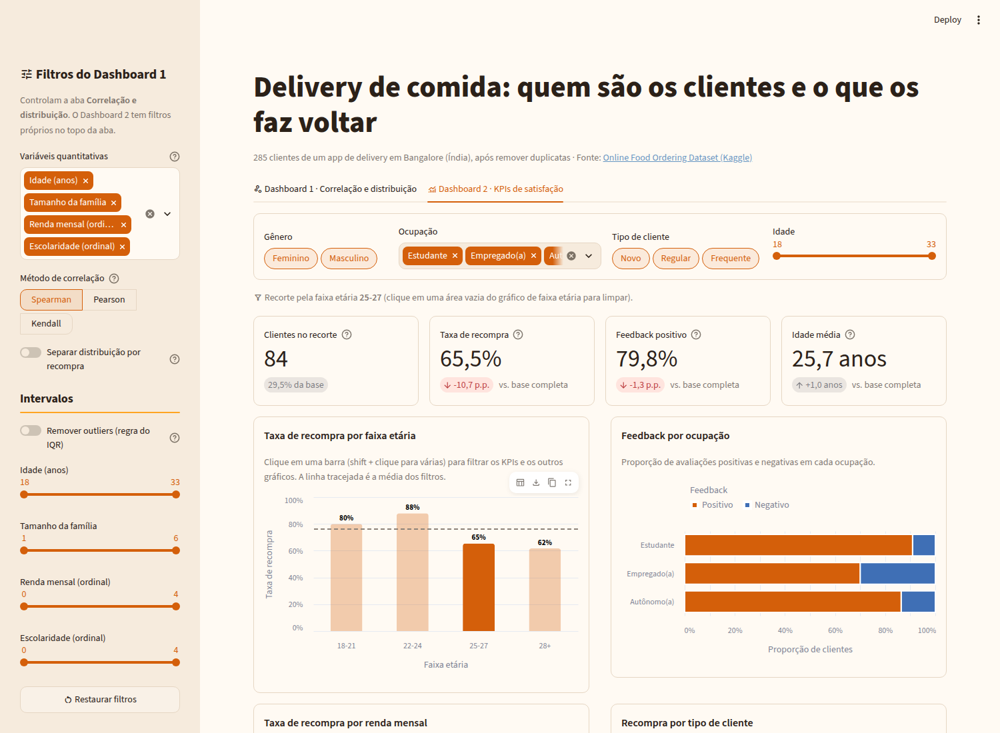
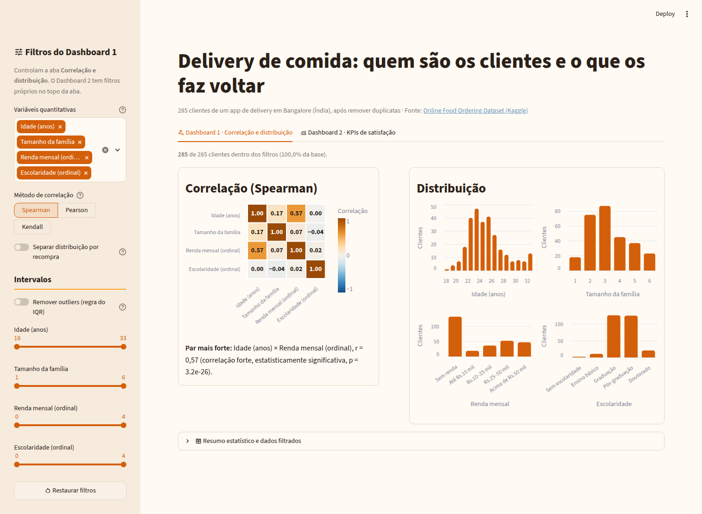

# Delivery de comida: quem são os clientes e o que os faz voltar

Dashboards interativos em **Streamlit** construídos a partir da minha análise exploratória (EDA) do [Online Food Ordering Dataset](https://www.kaggle.com/datasets/srisyra02/online-food-ordering-dataset): 285 clientes de um app de delivery em Bangalore (Índia).

**🔗 Link do app (Streamlit Community Cloud):** https://strean-64kppgkqvbj94erj8jfv5h.streamlit.app/

Projeto da disciplina **Análise e Visualização de Dados** (CESAR School, 2026.2), Aulas 21 a 23.
**Aluno:** Caio Leimig Rodrigues da Silva



## O que o app mostra

O app tem duas abas:

| Aba | Pergunta | Conteúdo |
|---|---|---|
| **Dashboard 1 · Correlação e distribuição** | Como as variáveis quantitativas se relacionam e se distribuem? | Heatmap de correlação (Spearman, Pearson ou Kendall) com o par mais forte e o p-valor, histogramas por variável, sliders de intervalo e remoção de outliers pela regra do IQR. |
| **Dashboard 2 · KPIs de satisfação** | Quem pediria novamente e quem está insatisfeito? | 4 KPIs (clientes, taxa de recompra, feedback positivo, idade média) com delta contra a base, e 4 visuais Altair. **Clicar numa faixa etária filtra KPIs e gráficos** (seleção cruzada). |

**Principais achados** (vindos da EDA e visíveis no app):
- A taxa de recompra cai de ~80–88% (até 24 anos) para ~62–65% a partir dos 25 anos.
- Empregados e autônomos têm a maior proporção de feedback negativo (Qui² ocupação × feedback, p ≈ 0,011).
- Idade e renda têm a correlação mais forte do conjunto (Spearman ≈ 0,57): a base é majoritariamente de estudantes sem renda.



## Stack

- **Python 3.12** · **Streamlit 1.66** (abas, sidebar, `st.metric`, `@st.cache_data`, tema em `.streamlit/config.toml`)
- **Altair** para todos os gráficos (seleção cruzada com `on_select="rerun"`)
- **pandas / SciPy** para tratamento, correlações e testes de significância
- **Jupyter** para EDA e pipeline de dados · **Streamlit Community Cloud** para o deploy

## Estrutura do repositório

```
├── app.py                        # app Streamlit (as duas abas)
├── src/
│   ├── data_loader.py            # leitura de data/clean/dataset.csv com @st.cache_data
│   ├── config.py                 # rótulos, ordens de categorias e cores
│   └── graficos.py               # funções que montam os gráficos Altair
├── data/
│   ├── raw/                      # dado bruto (não versionado)
│   └── clean/dataset.csv         # dado tratado (versionado: o deploy lê daqui)
├── notebooks/
│   ├── eda.ipynb                 # minha EDA original da Aula 11 (sem alterações)
│   ├── eda-com-downloads.ipynb   # pipeline: download → tratamento → teste de métricas → exportação
│   └── arquivo-eda-original.ipynb# EDA de referência da professora (consulta)
├── entregas/                     # rascunhos dos dashboards e justificativa das métricas
├── prompts/                      # prompts usados e declaração de uso de IA
├── tests/test_app.py             # testes de borda dos dashboards (AppTest)
├── docs/img/                     # screenshots usados neste README
├── .streamlit/config.toml        # identidade visual (tema claro e escuro)
├── ROTEIRO.md                    # passo a passo das aulas (material da disciplina)
└── ALTAIR-CROSSFILTER.md         # guia de seleção cruzada (material da disciplina)
```

## Como rodar localmente

Requer **Python 3.11 a 3.15**.

```bash
# 1. Criar e ativar o ambiente virtual
python3 -m venv .venv
source .venv/bin/activate            # Windows: .venv\Scripts\Activate.ps1

# 2. Instalar dependências (e, opcionalmente, as skills de IA do Streamlit)
python -m pip install -r requirements.txt
streamlit skills --yes

# 3. Rodar o app
streamlit run app.py

# 4. (Opcional) Rodar os testes de borda
python tests/test_app.py
```

Para regenerar o dado tratado, execute `notebooks/eda-com-downloads.ipynb` do início ao fim. Ele baixa o CSV bruto do Kaggle para `data/raw/` e exporta `data/clean/dataset.csv`.

### Problemas comuns

- **`python: command not found`:** use `python3` (macOS/Linux) ou `py` (Windows) para criar o venv; depois de ativado, `python` funciona.
- **Linux: `ensurepip is not available`:** `sudo apt install python3-venv`.
- **`ModuleNotFoundError` ou `streamlit: command not found`:** o venv não está ativo; ative de novo e confira o `(.venv)` no prompt.

## Dados: `data/raw` vs `data/clean`

| Pasta | Versionada? | Conteúdo |
|---|---|---|
| `data/raw/` | **Não** (só o `.gitkeep`) | CSV original do Kaggle, 388 linhas. |
| `data/clean/` | **Sim** | 285 linhas após o tratamento da EDA: duplicatas removidas, coluna redundante `Unnamed: 13` descartada, espaços extras limpos. Categorias traduzidas para português, mais `faixa_etaria`, `renda_nivel` e `escolaridade_nivel` (ordinais 0–4). `Pin code`, `latitude` e `longitude` removidos. |

O dataset é público (Kaggle) e não contém nomes, documentos ou contatos. O CSV original traz `latitude`/`longitude` (centroides de áreas de CEP, não endereços); mesmo assim, as coordenadas foram removidas do dado tratado por precaução, já que o app não as usa e não exibe mapa.

**Sobre `Output`:** o dataset não documenta formalmente essa coluna. Seguimos a leitura mais comum dele, de que `Yes` indica que o cliente **pediria novamente** pelo app (`pede_novamente` no dado tratado).

## Entregas da atividade

- Rascunhos de layout: [entregas/rascunho-dashboard1.png](entregas/rascunho-dashboard1.png) e [entregas/rascunho-dashboard2.png](entregas/rascunho-dashboard2.png)
- Justificativa das métricas: [entregas/justificativa-metricas.md](entregas/justificativa-metricas.md)
- Declaração de uso de IA: [prompts/declaracao-uso-ia.md](prompts/declaracao-uso-ia.md)
- Passo a passo das aulas: [ROTEIRO.md](ROTEIRO.md)

## IA neste projeto

O projeto usa o **streamlit skills**: instruções (`SKILL.md`) que a ferramenta de IA lê para escrever código Streamlit com a API atual. `streamlit skills --yes` cria `.claude/skills/` (Claude Code) e `.agents/skills/` (Gemini CLI) como *symlinks* para o venv. Por isso essas pastas **não são versionadas**: cada pessoa roda o comando no próprio clone.

O uso de IA está declarado em [prompts/declaracao-uso-ia.md](prompts/declaracao-uso-ia.md), e os prompts usados estão em [prompts/](prompts).
